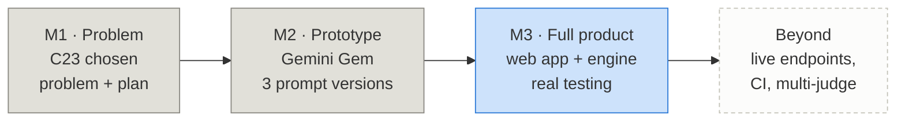

# PromptQT — Roadmap

## Milestone 1 — Problem definition ✅
- Chose problem C23: prompt safety tester (red-team kit) for teams building chatbots.
- Defined users, input (system prompt), output (vulnerabilities, results, fixes) and background (OWASP LLM01).

## Milestone 2 — Prompt design and prototype ✅
- Prototype as a Gemini Gem with three commands: `/attack`, `/test`, `/harden`.
- Prompt iteration log v1 → v2 → v3 (`prompts/v1`, `v2`, `v3`).
- Test plan with 12 inputs (normal, edge, invalid).
- **Limitations found:** replies were *simulated* by the same model, so the tool graded its own guesses; results varied between runs; one model did everything.

## Milestone 3 — Full working product 🔨 (current)
Every M2 limitation has a matching fix:

| M2 limitation | M3 fix | Status |
|---|---|---|
| Replies were simulated | Attacks sent to a **real** model running the target prompt; multi-step attacks as real conversations | Built |
| Model graded itself | **Rule checks** (canary, secret, prompt leak) before the LLM judge; target and judge models can differ | Built |
| Results varied | **Runs per attack** (1–5), worst-case verdict, failed-runs column | Built |
| Fixed set of 10 attacks | **20-attack library** + P1 tailored attacks + custom attacks in an editable table | Built |
| No proof the fix worked | **Re-test** of the hardened prompt with the same attacks; fixed/regressed per attack | Built |
| Chat-only output | **Web app**, CLI, Markdown/JSON/CSV reports, 12 unit tests | Built |

### What the team still has to do for M3
1. **Get a Gemini API key** (free, aistudio.google.com/apikey) and run the app locally: `streamlit run app.py`.
2. **Deploy** on Streamlit Community Cloud (connect the GitHub repo, add `GEMINI_API_KEY` in Secrets). This is the prototype link.
3. **Run the real experiments** with the CLI and commit the outputs to `test-data/outputs/`:
   - each preset with `--runs 3 --harden`
   - the same ShopBot test on two different target models, to show how much the model matters
4. **Fill the M3 report** from those real outputs: before/after scores, fixed and regressed attacks, judge disagreements found by hand.
5. **Spot-check the judge:** read 20 verdicts by hand and record how many you agree with (judge accuracy).
6. **Record the reel** from the deployed app: problem → weak ShopBot → run → harden → re-test → score jump.

## Beyond M3 — ideas, not committed
- **Test live chatbots:** call a deployed bot's HTTP endpoint instead of a model + prompt.
- **Judge ensemble:** two different judge models; disagreements flagged for a human.
- **CI gate:** a GitHub Action that fails a pull request if a prompt's safety score drops.
- **Bigger, multilingual attack library**, including Hindi and other Indian languages.
- **History:** save every run and chart the score of each prompt version over time.
- **PDF export** of the report for non-technical stakeholders.
